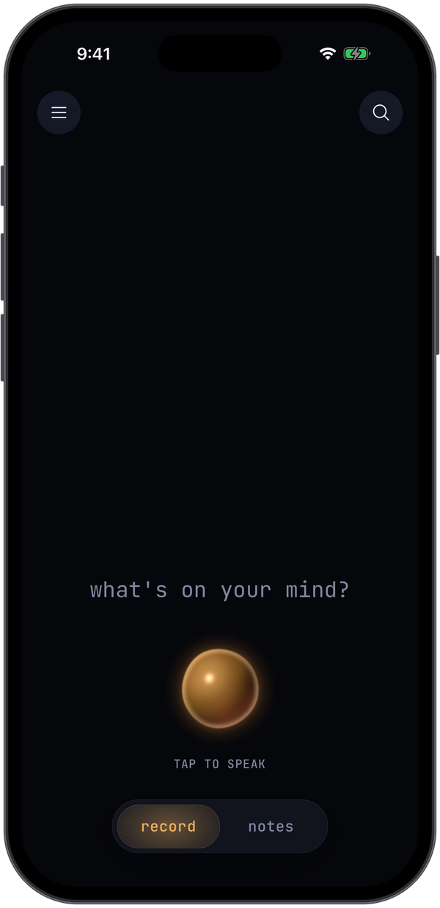
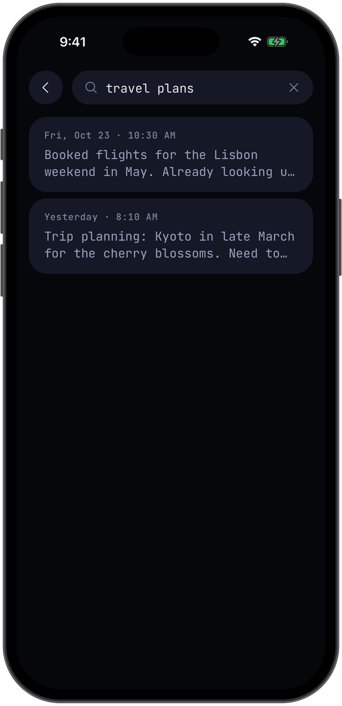

<p align="center">
  
</p>

# <p align="center">Pustakam</p>

<p align="center"><strong>A voice journal that lives entirely on your phone.</strong></p>

You don't need SOTA models for everything. I believe we need smaller, more intentional models: built for one job, and small enough to run on the phone you already carry. Pustakam is free, works offline and keeps nothing on a server. Your notes are yours, and they export as plain Markdown whenever you want.

If you want something free and you care about privacy, you no longer have to choose: runtimes like [LiteRT-LM](https://github.com/google-ai-edge/LiteRT-LM) and [ExecuTorch](https://github.com/pytorch/executorch) make real AI apps possible on the phone itself today.

<p align="center">
  
  &nbsp;
  
</p>

## Models

| For            | Model                                                                                                                             |
| -------------- | --------------------------------------------------------------------------------------------------------------------------------- |
| Speech to text | [Moonshine](https://github.com/moonshine-ai/moonshine) Small Streaming (English)                                                  |
| Search         | [EmbeddingGemma](https://huggingface.co/google/embeddinggemma-2) 270M on [LiteRT-LM](https://github.com/google-ai-edge/LiteRT-LM) |

## Install and run

You need a Mac to build for iOS. Android builds work on a Mac, Linux or Windows.

### 1. Tools

- [Node.js](https://nodejs.org) 20 or newer
- **iOS:** Xcode 16.1 or newer with the iOS simulator (`xcodebuild -downloadPlatform iOS`), and CocoaPods (`brew install cocoapods`). If `pod install` complains about encoding, add `export LANG=en_US.UTF-8` to your `~/.zshrc`.
- **Android:** [Android Studio](https://developer.android.com/studio), or just the command-line tools:

  ```bash
  brew install openjdk@17
  brew install --cask android-commandlinetools
  ```

  Then add these to your `~/.zshrc` and open a new terminal:

  ```bash
  export JAVA_HOME=/opt/homebrew/opt/openjdk@17/libexec/openjdk.jdk/Contents/Home
  export ANDROID_HOME=$HOME/Library/Android/sdk
  export PATH=$ANDROID_HOME/platform-tools:$PATH
  ```

  And install the SDK pieces this project builds against:

  ```bash
  SDKM=/opt/homebrew/share/android-commandlinetools/cmdline-tools/latest/bin/sdkmanager
  yes | $SDKM --sdk_root=$ANDROID_HOME --licenses
  $SDKM --sdk_root=$ANDROID_HOME "platform-tools" "platforms;android-36" "build-tools;36.0.0" "ndk;27.1.12297006" "cmake;3.22.1"
  ```

### 2. Get the code

```bash
git clone https://github.com/siddharthvaddem/pustakam.git
cd pustakam
npm install
npm run setup
```

`npm run setup` downloads the prebuilt iOS frameworks for Moonshine and LiteRT-LM (about 225 MB) and checks their checksums. They're too big to keep in git.

### 3. Run it

```bash
npm run ios       # iOS simulator
npm run android   # Android phone connected over USB
```

The first launch shows a download screen for the models. Speech recognition needs a microphone, so use a real phone (or your Mac's microphone through the iOS simulator).

### Build an Android APK to share

```bash
cd android
./gradlew assembleRelease -PreactNativeArchitectures=arm64-v8a
```

The APK lands in `android/app/build/outputs/apk/release/app-release.apk`. It's signed with a development key, which is fine for sideloading onto your own phones but not for the Play Store.

## License

This project is licensed under the [MIT License](LICENSE). By using this software, you agree that the authors are not liable for any issues, damages, or claims arising from its use.

Moonshine is MIT, LiteRT-LM is Apache-2.0, and EmbeddingGemma follows the [Gemma Terms of Use](https://ai.google.dev/gemma/terms).
